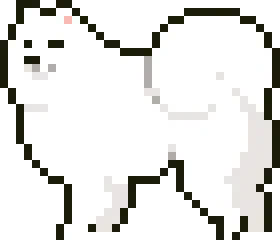

  <picture>
    <source media="(prefers-reduced-motion: reduce)" srcset="./assets/samoyed-banner.png" />
    
  </picture>

  <strong>Student developer in Singapore&nbsp;🇸🇬</strong> 
  Automation tools, ML models, and the occasional IoT gadget.

  <a href="#projects">Projects</a> ·
  <a href="#toolbox">Toolbox</a> ·
  <a href="#github-stats">Stats</a> ·
  <a href="#contributions">Snake</a>

<h2>About me</h2>

I'm Ben, an undergraduate at NUS studying Data Science, Economics & Chemistry. I build things to fix problems I actually have, from a bot that handles internship applications to a sensor that tells me when the laundry is done.

Most of my work is in Python and TypeScript, with some C++ when hardware gets involved.

<h2>Projects</h2>

### [Intern-Bot](https://github.com/SamoyedCodes/Intern-Bot)

A macOS app that autofills internship applications and tracks each one from saved to offer. Built with PySide6 and Playwright.

### [AutoPollEv](https://github.com/SamoyedCodes/autopollev)

Watches Poll Everywhere and votes for me, because I can't wake up for lecture.

### [FlowCast](https://github.com/SamoyedCodes/flowcast)

LightGBM forecasts of airport arrival capacity and delay risk for Autonomous SG 2026, Airbus Challenge #5.

### [Dra-Washer Monitor](https://github.com/SamoyedCodes/Student-Life-Track-2026)

An ESP32 vibration sensor and Azure Functions dashboard that detect washing machine cycles.

<h2>Toolbox</h2>

- **Languages:** `Python` · `TypeScript` · `Java` · `R` · `SQL`
- **Data & ML:** `pandas` · `NumPy` · `scikit-learn` · `Jupyter` · `Matplotlib`
- **Cloud & hardware:** `AWS EC2` · `Azure` · `Vercel` · `Arduino / ESP32`
- **Tools:** `Git` · `Playwright` · `pytest`

<h2>GitHub stats</h2>

Explore my [commit history](https://github.com/search?q=author%3ASamoyedCodes&type=commits&s=committer-date&o=desc) and [repositories](https://github.com/SamoyedCodes?tab=repositories) directly on GitHub.

  

  

  

Pixel cards: <a href="https://github.com/BaranDev/questlog-github-stats">questlog-github-stats</a>, art by Cevdet Baran Oral.

<h2>Contributions</h2>

  

<h2>More projects</h2>

**[Browse all my repositories →](https://github.com/SamoyedCodes?tab=repositories)**
